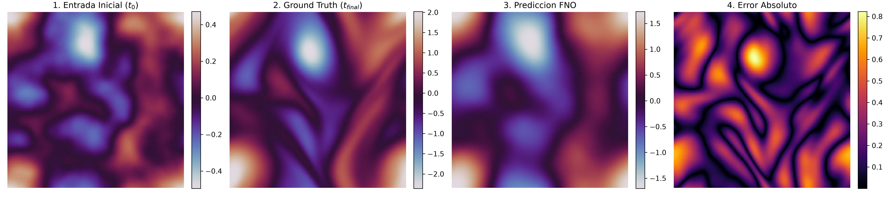

# Fourier Neural Operator 2D (PyTorch)

Modular PyTorch implementation of the **Fourier Neural Operator (FNO)** for learning resolution-invariant solution operators of non-linear partial differential equations (PDEs), evaluated on 2D incompressible Navier-Stokes equations ($\mathbb{T}^2$).

---

## Architecture & Mathematical Formulation

The Fourier Neural Operator maps an input continuous field $a \in \mathcal{A}$ to a solution field $u \in \mathcal{U}$ directly in function space:

$$G_\theta : \mathcal{A} \to \mathcal{U}$$

Each Fourier layer updates the latent field representation $v_t$ through a combination of a global integral kernel convolution in frequency space and a local linear transformation:

$$v_{t+1}(x) = \sigma \left( W v_t(x) + \left( \mathcal{K}(a; \phi) v_t \right)(x) \right)$$

where the spectral convolution operator $\mathcal{K}$ is parametrized in Fourier space via:

$$\left( \mathcal{K}(\phi) v_t \right)(x) = \mathcal{F}^{-1} \left( R_\phi \cdot \mathcal{F}(v_t) \right)(x)$$

- $\mathcal{F}, \mathcal{F}^{-1}$: Real 2D Fast Fourier Transform (`rfft2`) and Inverse FFT (`irfft2`).
- $R_\phi$: Learnable complex-valued tensor parameterizing truncated low-frequency modes.
- $W$: Local point-wise linear map implemented as a $1 \times 1$ convolution.
- $\sigma$: Non-linear activation function (GELU).

---

## Numerical Evaluation (Navier-Stokes 2D)

Evaluation of vorticity field evolution from initial state $t_0$ to final target state $t_{\text{final}}$ at $128 \times 128$ spatial resolution:



### Benchmark Summary
- **Spatial Resolution:** $128 \times 128$
- **Fourier Modes Retained:** $12 \times 12$
- **Hidden Channel Dimension (`width`):** 32
- **Trainable Parameters:** 1,188,289
- **Loss Function:** Relative $L_2$ norm

$$\mathcal{L}(u, \hat{u}) = \frac{\Vert{}u - \hat{u}\Vert{}_{L_2}}{\Vert{}u\Vert{}_{L_2}}$$

---

## Project Structure

```text
fno-pytorch/
├── fno/                     # Modular core library
│   ├── __init__.py          # Package interface
│   ├── layers.py            # SpectralConv2d implementation
│   ├── models.py            # FNO2d architecture (Lifting -> Blocks -> Projection)
│   └── losses.py            # Relative L2 loss function
├── scripts/
│   └── train.py             # Training and evaluation pipeline
├── requirements.txt         # Dependencies
├── .gitignore
└── README.md